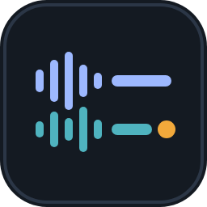

<p align="center"></p>

<h1 align="center">FreeCallNotes</h1>

<p align="center">Free, private call recording and transcription for Windows.<br>
Unzip, double-click, record. No installation, no account, nothing leaves your computer.</p>

---

FreeCallNotes records both sides of any call (Zoom, Teams, Google Meet, Webex, a phone app, anything that plays through your speakers) and turns it into a transcript you can hand to an AI assistant for notes.

- **Two clean tracks.** Your microphone ("User") and the computer's system sound ("System") are recorded separately, so the transcript knows who said what.
- **Doesn't get in the way.** It listens to the microphone in shared mode, so your meeting app keeps working normally.
- **Runs on your computer.** Speech recognition runs locally with open models (NVIDIA Nemotron, and optionally Moonshine). No cloud service, no subscription.
- **Live transcript** during the call, plus an optional second transcription afterwards for extra accuracy.
- **"Transcript for AI" file.** One text file with the transcript and clear instructions. Drop it into the AI assistant you're allowed to use and it writes clean notes, decisions and action items.
- **Portable.** Everything (app, models, recordings) lives in one folder. Delete the folder and it's gone.

> **Before you record:** in many places everyone on a call must agree to being recorded. You are responsible for getting consent and following your local law and your organisation's rules. See [DISCLAIMER.md](DISCLAIMER.md).

## Download and use

1. Download `FreeCallNotes-<version>-windows-x64.zip` from [Releases](../../releases).
2. Unzip it anywhere (Downloads, Documents, a USB stick).
3. Double-click **FreeCallNotes.exe**. The first time, it downloads the speech model (about 660 MB) into its own folder, and adds a desktop icon.
4. Press **Record** when your call starts and **Stop** when it ends. Your calls are saved in the `Call Notes` folder (you can change this in Options).

Requirements: Windows 10 or 11 (64-bit), about 2 GB of free disk space, 8 GB of RAM recommended. No GPU needed.

## How it works

```
 microphone ──► WASAPI (shared) ─┐                        ┌─► me.wav
                                 ├─► recorder process ────┤
 speakers ───► WASAPI loopback ──┘   (capture + save)     └─► them.wav
                                                               │ (followed while growing)
                                     transcription jobs ◄──────┘
                                     (separate processes: Nemotron during the call,
                                      optional Moonshine after the call)
                                                │
                                                ▼
                                 "Transcript for AI - <date>.txt"
```

- `callrec/capture.py` captures the microphone and the system-sound loopback with PyAudioWPatch and resamples both to 16 kHz mono.
- `callrec/engine.py` saves both tracks continuously and keeps them aligned in time (silence is padded so the tracks stay in sync).
- `callrec/post.py` runs the speech models in separate processes that follow the growing WAV files: NVIDIA Nemotron Speech Streaming (via sherpa-onnx) and Moonshine v2.
- `callrec/export.py` builds the "Transcript for AI" file, including flags for lines that look like speaker echo leaking into the microphone.
- `callrec/server.py` + `callrec/ui.html` provide the interface: a small local web page (127.0.0.1 only) shown in a Microsoft Edge app window.
- `launcher/` is a tiny Windows program (`FreeCallNotes.exe`) that starts the bundled Python.

More detail: [docs/ARCHITECTURE.md](docs/ARCHITECTURE.md).

## Building from source

```
python build/build_windows.py
```

This downloads the embeddable Python, the pinned Windows packages from `build/requirements-windows.txt`, compiles the launcher (needs MinGW-w64) and writes `dist/FreeCallNotes-<version>-windows-x64.zip`. See the script's header for details.

To run from source on Windows during development: install Python 3.12 and the packages in `build/requirements-windows.txt`, then run `python -m callrec` from the repository folder.

## Contributing

Contributions are welcome. Please read [CONTRIBUTING.md](CONTRIBUTING.md). Before your first pull request is merged you'll be asked to agree to the [Contributor License Agreement](CLA.md).

## License

FreeCallNotes is free software: you can redistribute it and/or modify it under the terms of the **GNU General Public License v3.0 or later**. See [LICENSE](LICENSE).

It is distributed in the hope that it will be useful, but **without any warranty**; without even the implied warranty of merchantability or fitness for a particular purpose.

Third-party components and the speech models have their own licenses: see [THIRD_PARTY_NOTICES.md](THIRD_PARTY_NOTICES.md). Privacy: [PRIVACY.md](PRIVACY.md). Disclaimer: [DISCLAIMER.md](DISCLAIMER.md).

FreeCallNotes is an independent project. It is not affiliated with or endorsed by NVIDIA, Microsoft, Zoom, Google or any other company named here. Names are trademarks of their owners and are used only to describe compatibility.
